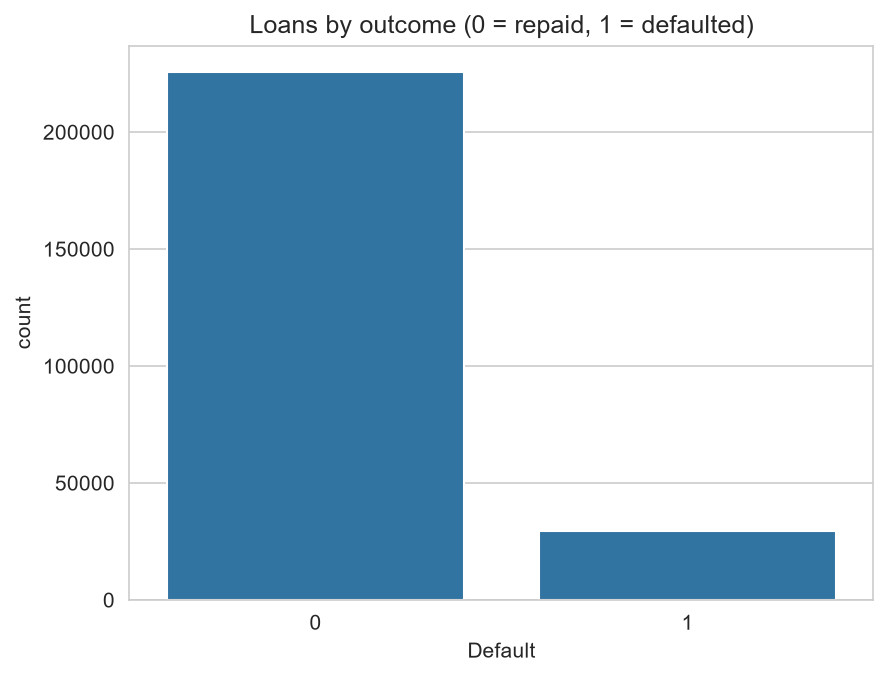
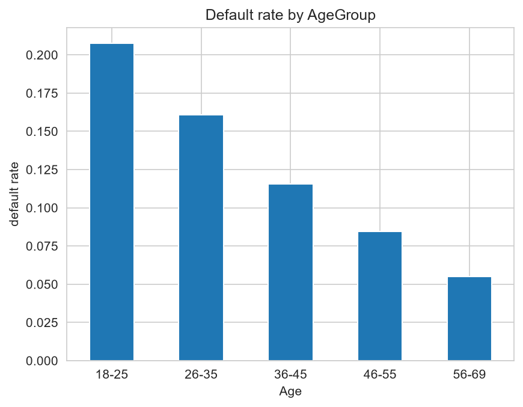
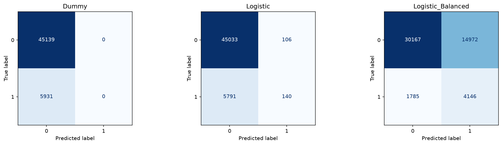
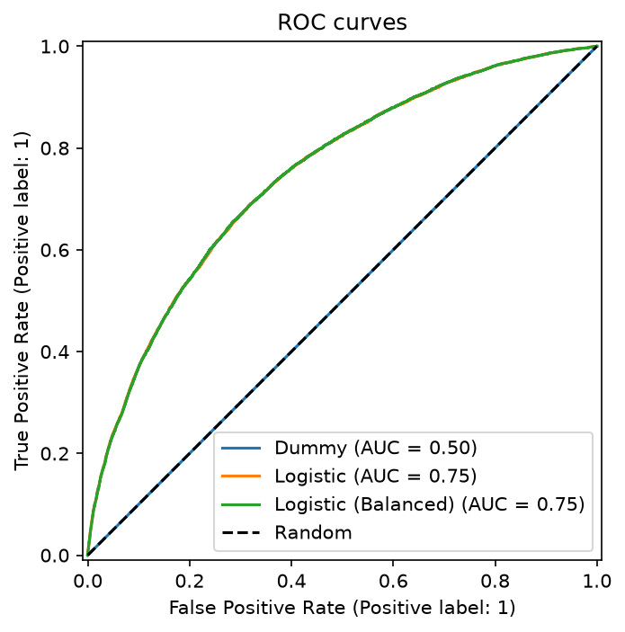

# Loan Default Prediction API

Predicts whether a loan applicant will default, using a machine learning model stored in Postgres and served through a FastAPI API in Docker.

## Status
Day 9: baseline models and evaluation metrics complete. Next: preprocessing pipeline with categorical features, then tree-based models.

## Tech stack
Python, uv, NumPy, pandas, matplotlib, seaborn, SQLAlchemy, scikit-learn, PostgreSQL, FastAPI, Docker

## Project plan
- [x] Exploratory data analysis
- [x] Load cleaned data into Postgres
- [x] Baseline models and evaluation metrics
- [ ] Train and compare 3 models
- [ ] Serve the best model with FastAPI
- [ ] Dockerize and deploy

## Dataset
255,347 loans with 16 features, the target `Default` (1 = defaulted, 0 = repaid) and a loan ID. There are no missing values and no duplicate rows.

Source: [Loan Default dataset on Kaggle](https://www.kaggle.com/datasets/nikhil1e9/loan-default). Download the CSV and save it as `data/loans.csv` (the `data/` folder is not committed to Git).

## Findings from EDA
Full analysis: [`notebooks/01_eda.ipynb`](notebooks/01_eda.ipynb)

- **The data is imbalanced.** 11.6% of loans default (29,653 of 255,347), about 7.6 repaid loans for every default. Models are judged on precision, recall, F1 and ROC-AUC, not accuracy.
- **Defaulted loans differ from repaid loans:**

| Feature (average) | Defaulted | Repaid |
|---|---|---|
| Age | 36.6 | 44.4 |
| Income | 71,845 | 83,899 |
| Loan amount | 144,515 | 125,354 |
| Credit score | 559 | 576 |
| Interest rate (%) | 15.9 | 13.2 |

- **Employment matters most among categories:** unemployed borrowers default at 13.6%, full-time workers at 9.5%. Education, marital status and loan purpose differ by only 2 to 3 percentage points.
- **Age is the strongest signal:** the default rate falls from 20.8% (ages 18-25) to 5.5% (ages 56-69).
- **Strongest correlations with default:** age (-0.17), interest rate (+0.13), income (-0.10), months employed (-0.10), loan amount (+0.09). Credit score is weak (-0.03).
- **Features are almost uncorrelated with each other**, so none is redundant.





## Results
Full analysis: [`notebooks/02_modeling.ipynb`](notebooks/02_modeling.ipynb)

Baseline models use the 12 numeric columns only, with a stratified 80/20 train/test split (204,277 training rows, 51,070 test rows, 11.6% defaults in both). Scaling is done inside a pipeline, so it learns from the training data only.

| Model | Accuracy | Precision | Recall | F1 | ROC-AUC | PR-AUC |
|---|---|---|---|---|---|---|
| Dummy (always "no default") | 0.884 | 0.000 | 0.000 | 0.000 | 0.500 | 0.116 |
| Logistic regression | 0.885 | 0.569 | 0.024 | 0.045 | 0.747 | 0.300 |
| Logistic regression, balanced class weights | 0.672 | 0.217 | 0.699 | 0.331 | 0.747 | 0.299 |
| Logistic regression, threshold 0.20 | 0.818 | 0.302 | 0.431 | 0.355 | 0.747 | 0.300 |

- **Accuracy is misleading here.** The dummy scores 88.4% by never predicting a default, and plain logistic regression catches only 140 of 5,931 defaults.
- **Class weights and a lower threshold trade precision for recall.** The balanced model catches 69.9% of defaults but flags 14,972 repaid loans. Lowering the threshold of the plain model to 0.20 gives the best F1 so far (0.355): 2,556 defaults caught, 5,915 repaid loans flagged.
- **Ranking quality is moderate and unchanged by either method.** ROC-AUC is 0.747 for both logistic models, which is consistent with the weak signals found in the EDA.
- **The threshold was chosen on the test set**, so the 0.20 result is slightly optimistic. Later stages will choose it on a validation split or with cross-validation.




## Project structure
```
data/        raw and cleaned CSV files (not committed)
notebooks/   01_eda.ipynb (exploration), 02_modeling.ipynb (baseline models and metrics)
reports/     saved charts
src/         reusable code (loan_data.py: load, clean, save to and read from Postgres)
```

## How to run
Requires [uv](https://docs.astral.sh/uv/) and Docker.

1. Install dependencies:
   ```
   uv sync
   ```
2. Start Postgres (use your own password):
   ```
   docker run --name loan-db -e POSTGRES_PASSWORD=your_password -e POSTGRES_DB=loans -p 5432:5432 -v loan-data:/var/lib/postgresql/data -d postgres:16
   ```
   If port 5432 is already in use, map another one (for example `-p 5433:5432`) and use the same port below.
3. Create a `.env` file in the repo root with matching values:
   ```
   POSTGRES_USER=postgres
   POSTGRES_PASSWORD=your_password
   POSTGRES_DB=loans
   POSTGRES_HOST=localhost
   POSTGRES_PORT=5432
   ```
4. Put the dataset at `data/loans.csv`, then check that it loads:
   ```
   uv run python src/loan_data.py
   ```
5. Open `notebooks/01_eda.ipynb` and run all cells. This also loads the data into the `loans` table in Postgres.
6. Open `notebooks/02_modeling.ipynb` and run all cells. It reads the data back from Postgres.

## Limitations
- The dataset appears synthetic: features are almost uncorrelated and credit score is nearly uninformative. Results show the pipeline, not real lending behaviour.
- Age, marital status and education are sensitive attributes. A real credit model would need fairness checks and legal review.
- Baseline models ignore the four text columns so far; they are added in the next stage.
