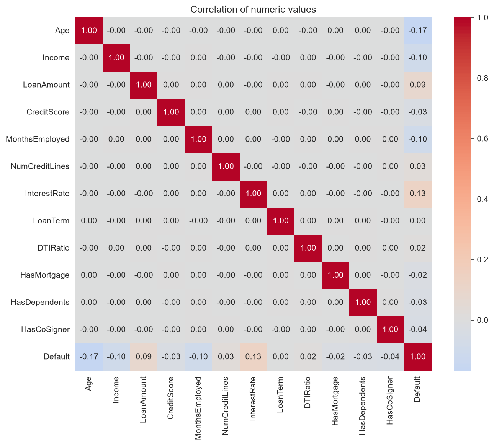

# Loan Default Prediction API

Predicts whether a loan applicant will default, using a machine learning model stored in Postgres and served through a FastAPI API in Docker.

## Status
Day 6: exploratory data analysis complete and data loaded into Postgres. Next: baseline model and evaluation.

## Tech stack
Python, uv, NumPy, pandas, matplotlib, seaborn, SQLAlchemy, scikit-learn, PostgreSQL, FastAPI, Docker

## Project plan
- [x] Exploratory data analysis
- [x] Load cleaned data into Postgres
- [ ] Train and compare 3 models
- [ ] Serve the best model with FastAPI
- [ ] Dockerize and deploy

## Dataset
255,347 loans with 17 columns plus a loan ID. The target is `Default` (1 = defaulted, 0 = repaid). There are no missing values and no duplicate rows.

Source: [Loan Default dataset on Kaggle](https://www.kaggle.com/datasets/nikhil1e9/loan-default). Download the CSV and save it as `data/loans.csv` (the `data/` folder is not committed to Git).

## Findings from EDA
Full analysis: [`notebooks/01_eda.ipynb`](notebooks/01_eda.ipynb)

- **The data is imbalanced.** 11.6% of loans default (29,653 of 255,347), about 7.6 repaid loans for every default. Models will be judged on recall, F1 and ROC-AUC, not accuracy.
- **Defaulted loans differ from repaid loans:**

| Feature (average) | Defaulted | Repaid |
|---|---|---|
| Age | 36.6 | 44.4 |
| Income | 71,845 | 83,899 |
| Loan amount | 144,515 | 125,354 |
| Credit score | 559 | 576 |
| Interest rate (%) | 15.9 | 13.2 |

- **Employment matters most among categories:** unemployed borrowers default at 13.6%, full-time workers at 9.5%. Education, marital status and loan purpose differ by only 2 to 3 percentage points.
- **Strongest correlations with default:** age (-0.17), interest rate (+0.13), income (-0.10), months employed (-0.10), loan amount (+0.09). Credit score is weak (-0.03).
- **Features are almost uncorrelated with each other**, so none is redundant.




## Project structure
```
data/        raw and cleaned CSV files (not committed)
notebooks/   exploration (01_eda.ipynb)
reports/     saved charts
src/         reusable code (loan_data.py: load, clean, save to and read from Postgres)
```

## How to run
Requires [uv](https://docs.astral.sh/uv/) and Docker.

1. Install dependencies:
   ```
   uv sync
   ```
2. Start Postgres (use your own password):
   ```
   docker run --name loan-db -e POSTGRES_PASSWORD=your_password -e POSTGRES_DB=loans -p 5432:5432 -v loan-data:/var/lib/postgresql/data -d postgres:16
   ```
   If port 5432 is already in use, map another one (for example `-p 5433:5432`) and use the same port below.
3. Create a `.env` file in the repo root with matching values:
   ```
   POSTGRES_USER=postgres
   POSTGRES_PASSWORD=your_password
   POSTGRES_DB=loans
   POSTGRES_HOST=localhost
   POSTGRES_PORT=5432
   ```
4. Put the dataset at `data/loans.csv`, then check that it loads:
   ```
   uv run python src/loan_data.py
   ```
5. Open `notebooks/01_eda.ipynb` and run all cells. This also loads the data into the `loans` table in Postgres.

## Results
To be added: comparison of 3 models (F1, recall, ROC-AUC) after the modelling stage.

## Limitations
- The dataset appears synthetic: features are almost uncorrelated and credit score is nearly uninformative. Results show the pipeline, not real lending behaviour.
- Age, marital status and education are sensitive attributes. A real credit model would need fairness checks and legal review.
